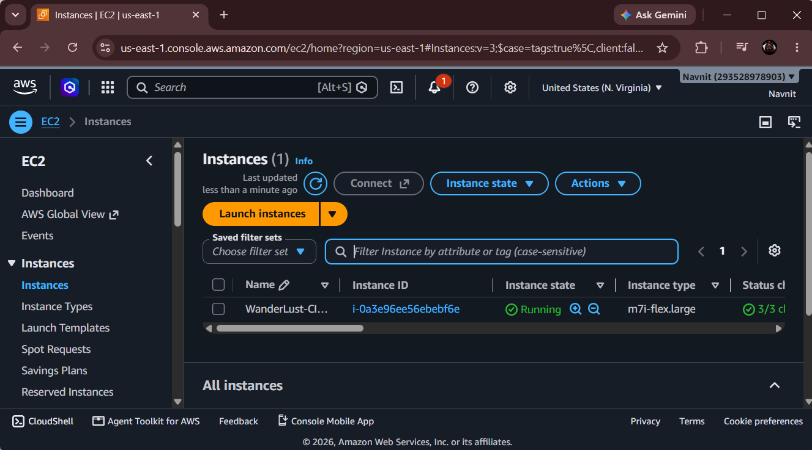
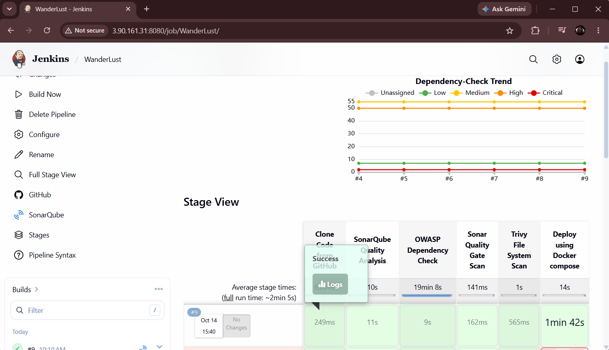
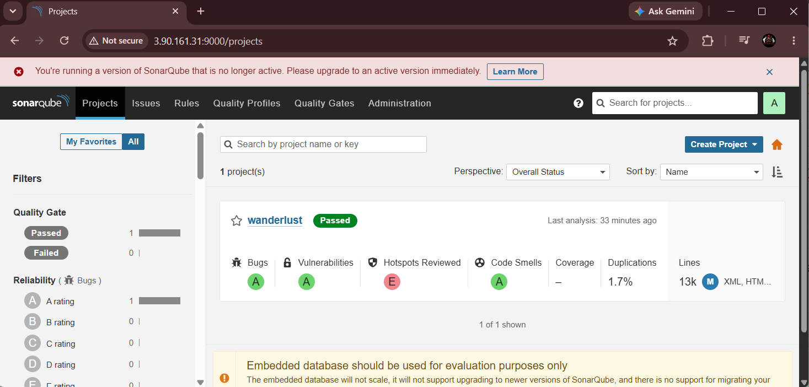
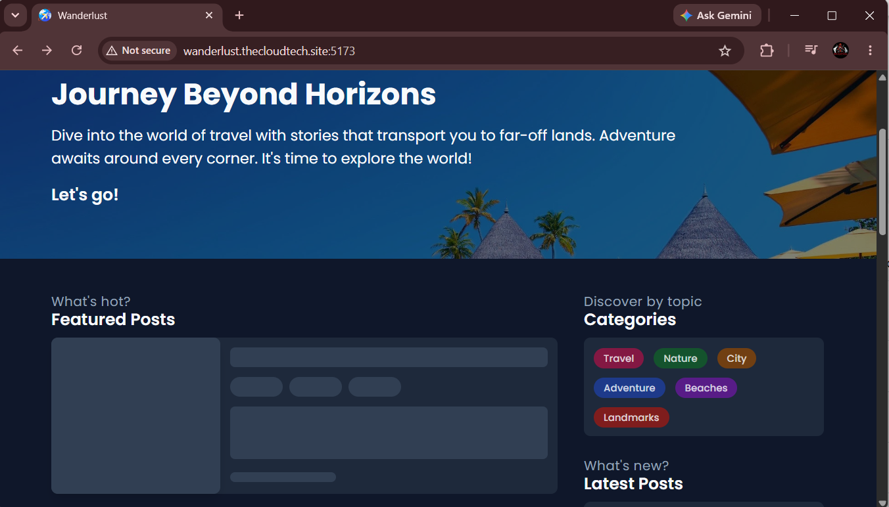

# 🌍 WanderLust: DevSecOps End-to-End CI/CD Pipeline

**WanderLust** is a full-stack web application secured and deployed using an end-to-end **DevSecOps CI/CD pipeline**. By enforcing a "Shift-Left" security strategy, this architecture automatically tests code quality, uncovers library vulnerabilities, patches container layers, and safely automates production-ready delivery.

---

## 🛠️ DevSecOps Architecture & Toolchain

| Stage | Tool / Tech | Purpose |
| :--- | :--- | :--- |
| **Orchestration** | [Jenkins](https://jenkins.io "Jenkins official site") | Drives the automated pipeline script (`Jenkinsfile`) |
| **SAST Analysis** | [SonarQube](https://sonarqube.org "SonarQube official site") (In Docker) | Static code quality gates, code smell checks & bug tracking |
| **SCA Scanning** | [OWASP Dependency-Check](https://owasp.org "OWASP Dependency Check") | Analyzes project dependencies for known CVE vulnerabilities |
| **Container Security** | [Trivy](https://github.io "Trivy documentation") | Scans filesystems & final Docker image layers for vulnerabilities |
| **Runtime Container**| [Docker Engine & Compose](https://docker.com "Docker official site") | Package application services and spin up local infrastructure |

---

## 📋 Pipeline Workflow Layout

The declarative `Jenkinsfile` maps out a highly resilient automated lifecycle:

1. **Git Checkout:** Pulls targeted branch code directly into the workspace environment.
2. **SonarQube Analysis (SAST):** Fires `sonar-scanner` to check code consistency and vulnerabilities.
3. **OWASP Dependency Check (SCA):** Verifies third-party Node modules against vulnerability databases.
4. **Sonar Quality Gate:** Halts execution if code metrics drop below accepted baselines.
5. **Trivy Filesystem Scan:** Runs `trivy fs` to isolate underlying file system risks early.
6. **Build & Security Scan:** Builds the Docker container image and applies image layer scanning.
7. **Deploy:** Spins up application microservices natively via `docker-compose up -d`.

---
## 🚀 Infrastructure Setup & Quick Start

### 1. Prerequisites & Tool Configurations
Ensure your target server (e.g., AWS EC2 instance) has **Docker** and **Trivy** pre-installed. 

**Spin up the SonarQube Container instance:**
```bash
docker run -d --name sonarqube -p 9000:9000 sonarqube:lts-community
```

### 2. Jenkins Server Setup
1. Install essential plugins via **Manage Jenkins** ➡️ **Plugins**:
   - `SonarQube Scanner`
   - `OWASP Dependency-Check`
   - `Docker Pipeline`
2. Map Webhook access and link authentication tokens generated under `http://<your-ip>:9000` inside your Jenkins Global Credentials manager.

### 3. Running the Pipeline
1. Create a **New Item** in Jenkins, naming it a **Pipeline** job type.
2. Under **Pipeline Definition**, choose *Pipeline script from SCM*.
3. Add your repository link: `https://github.com`.
4. Define your script path (`Jenkinsfile`) and select **Build Now** to execute the automation sequence.

---

### 🏠 Infrastructure Environment


*Figure 1: Production hosting running on an AWS EC2 instance (`m7i-flex.large`).*

---

## 📊 Pipeline Build & Verification Metrics

### 1. Jenkins Pipeline Execution
The pipeline tracks seven core security and delivery stages. The integration runs automated code retrieval, dependencies verification using **OWASP Dependency-Check**, container vulnerability scans via **Trivy**, and localized container creation.


*Figure 2: Successful execution flow across all pipeline stages in the Jenkins dashboard.*

### 2. SonarQube Static Application Security Testing (SAST)
Static scans analyze codebase parameters across 13k+ lines of code to enforce quality gates before building artifacts.


*Figure 3: Codebase review showing a passing status for the project quality gate.*

### 3. Container Runtime State
Services operate in detached environments managed by container network definitions inside the host system.


*Figure 4: Active runtime status of the frontend, backend, database, cache, and SonarQube container instances.*

---

## 🖥️ Live Application Deployment Preview

Once the pipeline successfully finishes the `Deploy using Docker compose` phase, the web client becomes accessible over port `5173`.

### Accessing via IP / Localhost

*Figure 5: Target application landing interface verified active via public IP hosting.*

### Accessing via DNS Routing

*Figure 6: Live production storefront showing the thematic discover layout and travel category filters.*

### Blog Post Configuration

*Figure 7: Target details visualization view showcasing dynamic content and user post publishing features.*

---


## 🔒 Security Policy
All deployment builds **must clear zero-tolerance thresholds** for Critical vulnerabilities flagged by both Trivy and OWASP scanners before entering public production stages.
